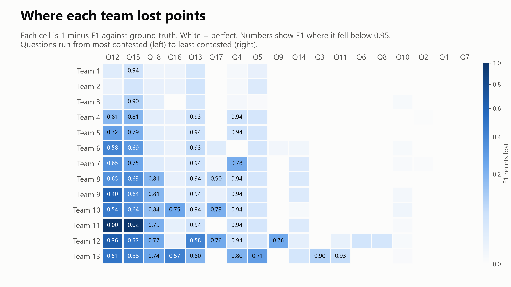
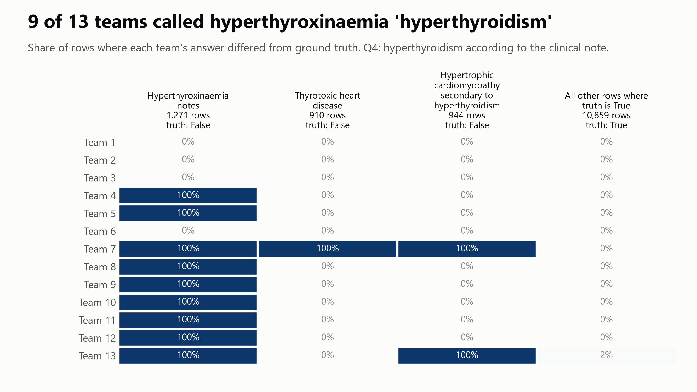
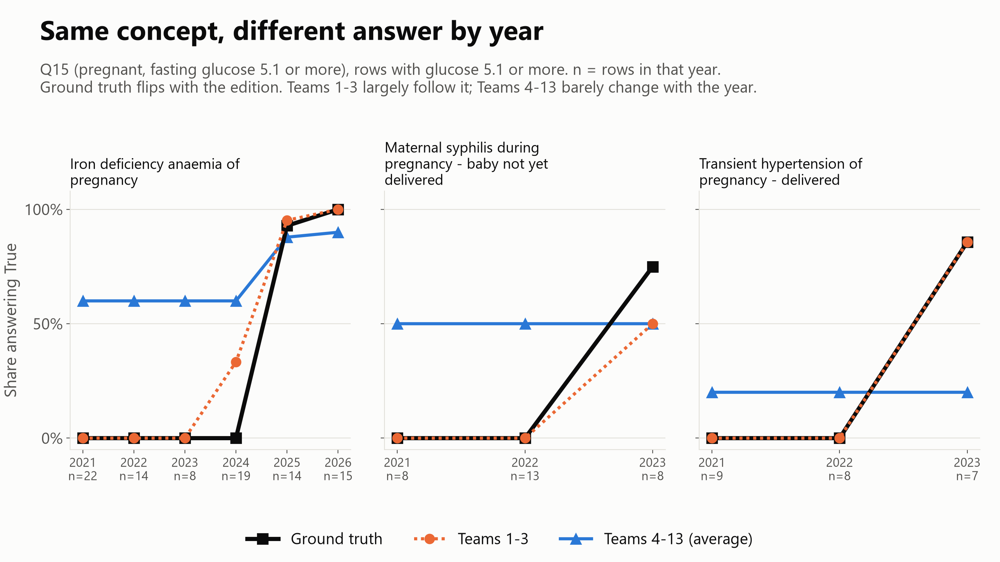
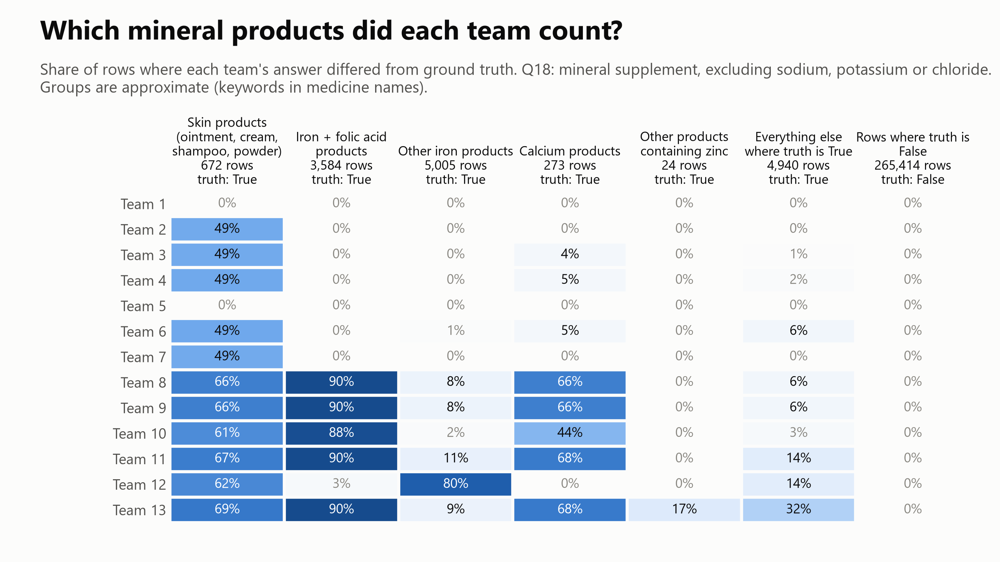
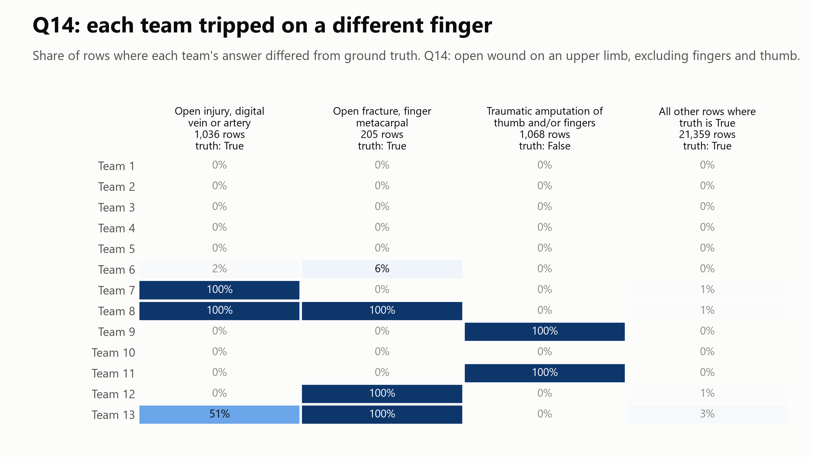
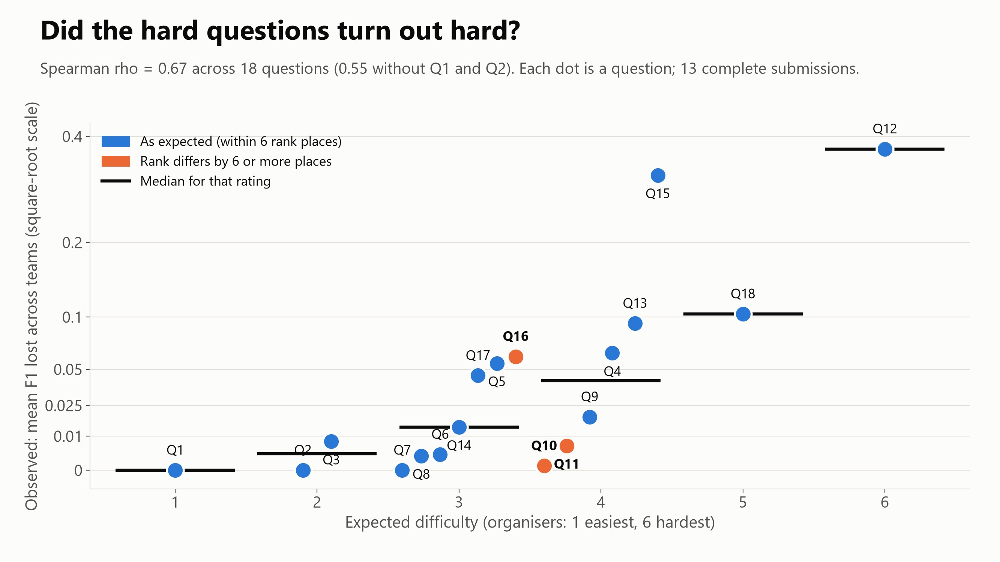

# Data Golf 2026: Competition Report

Matt Cordell · 12 October 2026

## Summary

Thirteen complete submissions answered 18 SNOMED CT cohort questions over 279,912 synthetic encounters, and the top three finished within 0.0024 macro F1 of each other (0.9922, 0.9914, 0.9898). Most questions were answered almost perfectly by almost everyone. The points were won and lost on a handful of questions where the terminology, the edition, or the wording left room for judgement.

Four patterns stand out:

1. **The hierarchy and the clinical meaning can pull apart.** On Q4 (hyperthyroidism), nine of 13 teams counted two euthyroid hyperthyroxinaemia concepts that the answer key excludes. Seven teams produced an identical answer column.
2. **The same concept can have a different right answer in different years.** On Q15 (pregnant, fasting glucose of 5.1 mmol/L or more), only the top three teams tracked concepts whose membership of the pregnancy grouping changed between editions. Most others behaved as if one edition applied to all six years.
3. **The question's wording and the ingredient model give different answers.** On Q18 (mineral supplement), the answer key follows ingredients, so zinc oxide nappy-rash ointments count. Teams split on those and on iron with folic acid combinations.
4. **Words in a term are not the model.** On Q14 (open wound of upper limb, excluding fingers and thumb), teams that appear to have read concept names for "finger" or "digital" went wrong in both directions, each in a different way.

The organisers' pre-event difficulty ratings tracked the outcomes well (Spearman rho 0.67 against F1 lost, p = 0.002). They picked out the hardest questions and were weaker in the middle of the scale.

Practical lessons for anyone analysing longitudinal SNOMED CT data are listed under Learnings for analysts. In short: decide and state your edition strategy, read your expanded value sets against real data rather than trusting a single subsumption query, and treat an ambiguous criterion as a definition to write down before it becomes a query.

## The competition

Data Golf 2026 was a free, educational Kaggle competition hosted by CSIRO's Australian e-Health Research Centre. It ran from 26 August to 27 September 2026, with results presented at the SNOMED CT 2026 Expo in Sydney.

| Element | Detail |
| --- | --- |
| Task | Answer 18 yes/no clinical questions (Q1 to Q18) for every encounter |
| Data | 279,912 synthetic encounters, 2021 to 2026, each with demographics, one coded clinical note, up to three coded medicines and laboratory results |
| Terminology | Six SNOMED CT-AU editions (20210131 to 20260131); SNOMED CT clinical drugs before 2025, AMT products from 2025 |
| Rule of the game | Answer each encounter using the edition current on its encounter date |
| Tools | Any; FHIR terminology services (Ontoserver) and ECL recommended, RF2 as an alternative |
| Metric | Macro F1: F1 per question, averaged so every question counts equally regardless of prevalence |
| Leaderboard | 50:50 public and private split |
| Entries | 15 submissions; 13 complete, 2 partial |

**What F1 means.** F1 is a score from 0 to 1 for how well a team's True answers matched the answer key. It counts both kinds of mistake: patients the team missed, and patients it wrongly included. A score of 1 means every patient was right; 0 means none of the team's True answers were. A team's competition score, macro F1, is its F1 averaged over the 18 questions. The question table below turns it the other way: mean F1 is one question's F1 averaged across the 13 teams.

**Why macro F1.** Most questions have few True patients: Q7 has 239 in 279,912. A team answering False everywhere would score 99.9% accuracy on Q7 but an F1 of 0, so F1 rewards finding the right patients rather than agreeing on the easy negatives. Averaging F1 per question (macro), rather than pooling every answer into one score, makes each question count equally, so the rare and difficult questions are not drowned out by common ones such as Q1 (139,606 True).

The golf framing was a presentation device: 18 questions for 18 holes. The set was cut from an earlier 37-question draft, dropping questions that depended on withheld columns or tested general data skills rather than terminology.

## The 18 questions and why they were chosen

Each question was chosen to test a specific skill in querying SNOMED CT with ECL, and rated before the event from 1 (easiest) to 6 (hardest). This rating is each question's par: as on a golf course, it is the organiser's estimate of how hard a hole should play, set before anyone tees off. The table sets par beside how each hole actually played. Mean F1 is across the 13 complete submissions; observed rank 1 is the hardest.

**How well par predicted difficulty.** Par was a good guide overall: the rank correlation between par and observed difficulty was 0.67, where 1 would be perfect agreement and 0 none. It was strongest at the hard end, with Q12 (par 6) playing hardest and Q18 (par 5) third. It was weaker in the middle: Q15 (par 4) played second hardest, while Q10 and Q11 (also par 4) played among the easiest.

| Q | Criterion | Main skill tested | Par (difficulty 1 to 6) | True rows | Mean F1 | Observed rank |
| --- | --- | --- | --- | --- | --- | --- |
| Q1 | Female as recorded sex | Basic lookup | 1 | 139,606 | 1.000 | 17 to 18 |
| Q2 | BMI 30 or more and cholesterol:HDL above 5 | Data wrangling, no SNOMED CT | 2 | 45,542 | 1.000 | 16 |
| Q3 | Healthy or free of current problems | First ECL; a concept outside the obvious hierarchy | 2 | 15,731 | 0.992 | 11 |
| Q4 | Hyperthyroidism according to the clinical note | Edition drift (2022 change); precision | 4 | 10,859 | 0.936 | 5 |
| Q5 | Osteoarthritis in 2024 | Large edition drift | 3 | 3,819 | 0.945 | 7 |
| Q6 | Taking an ACE inhibitor | Drug class through ingredients | 3 | 9,059 | 0.996 | 13 |
| Q7 | Taking a cardiac (digitalis) glycoside | Drug class through ingredients | 3 | 239 | 1.000 | 17 to 18 |
| Q8 | Fungal foot infection | Composing an ECL where no single concept exists | 3 | 179 | 0.997 | 14 |
| Q9 | More than one paracetamol product | Counting across medicine columns | 4 | 3,230 | 0.981 | 9 |
| Q10 | Bilateral condition | Complex ECL, left and right finding sites | 4 | 7,038 | 0.999 | 15 |
| Q11 | Female, 15 to 49, on methotrexate | Multiple criteria with calculated age | 4 | 2,250 | 0.994 | 12 |
| Q12 | Pregnant and prescribed a teratogen | Pregnancy identification; self-built drug list | 6 | 347 | 0.627 | 1 |
| Q13 | OA or RA, oral NSAID, eGFR below 60 | Drift, complex ECL, dose form | 4 | 1,819 | 0.907 | 4 |
| Q14 | Open wound, upper limb, not fingers or thumb | ECL over the anatomy hierarchy | 3 | 22,600 | 0.986 | 10 |
| Q15 | Pregnant with fasting glucose 5.1 mmol/L or more | Pregnancy identification plus a lab value | 4 | 461 | 0.681 | 2 |
| Q16 | Non-Streptococcal bacterial joint infection | Attributes combined with subtraction | 3 | 1,472 | 0.939 | 6 |
| Q17 | Taking an oral iron supplement | Substance grouper and dose form | 3 | 10,649 | 0.955 | 8 |
| Q18 | Mineral supplement, not Na, K or Cl | Building your own enumerated list | 5 | 14,498 | 0.897 | 3 |

The questions fall into six groups:

- **Warm-ups (Q1 to Q3).** Confirm the file can be read; Q3 introduces ECL with a trap, because *No current problems or disability* is not a subtype of *Healthy*.
- **Terminology drift (Q4, Q5).** In the 2022 edition *Thyrotoxicosis* (90739004) stopped being a subtype of *Hyperthyroidism* (34486009). The *Osteoarthritis* subtree shrank sharply between the 2025 and 2026 editions.
- **Drug classes through ingredients (Q6, Q7, Q17).** SNOMED CT has no "ACE inhibitor product" grouper, so classes are reached through *Has ingredient*. Q17 needs *Product containing iron and/or iron compound* (768459000), not *Product containing iron* (30729008), plus the dose form to drop injectable iron.
- **Composing an ECL (Q8, Q10, Q14, Q16).** No single concept fits; participants combine concepts, laterality, anatomy subtraction or causative agent.
- **Safety checks with several criteria (Q9, Q11, Q12, Q13, Q15).** Mirror real medicine-safety rules. Q12's teratogen concept (45986006) has no subtypes, so participants had to build their own substance list.
- **Building your own list (Q18).** *Mineral supplement (substance)* (373460003) has children, but none are substances that products actually use. The wording follows ATC group A12 and was known to be open to interpretation; variation was expected and accepted.

## How the data and answer key were built

The dataset is synthetic, built so that terminology change between editions would visibly change the answers. It describes no real people.

**Generation.** The banksia synthetic patient generator produced one cohort per SNOMED CT-AU edition period (February to January, 2021 to 2026). Codes were drawn from the edition current for that period. Medicines used strength-bearing SNOMED CT clinical drugs before 2025 and AMT products from 2025. The six cohorts were combined and sorted by encounter date.

**Answer key.** Every question's ECL was expanded once per edition on Ontoserver and applied only to encounters in that edition's period. The answers are therefore encounter-relative: a row is judged by the terminology in force when it was recorded. Medicine criteria also carry a display-text fallback for products outside the expansion.

**Choosing questions with unstable terminology.** Candidate ECLs were expanded against all six editions and those whose member count moved by 20% or more were flagged:

| Candidate criterion | Members, 2021 to 2026 editions | Spread | Question |
| --- | --- | --- | --- |
| Hyperthyroidism | 67, 21, 21, 22, 23, 26 | 69% | Q4 |
| Bilateral condition | 1,147 up to 2,833 | 60% | Q10 |
| Pregnancy | 1,602, 1,258, 775, 1,314, 1,266, 1,232 | 52% | Q12, Q15 |
| Rheumatoid arthritis | 60 up to 114 | 51% | Q13 |
| Osteoarthritis | 294 up to 350, then 181 | 48% | Q5, Q13 |
| Non-Streptococcal bacterial joint infection | 69 up to 106 | 35% | Q16 |

These were preliminary ECLs, not the final ones, but they showed where the terminology moves.

**Seeding drift on purpose.** Random code selection left some questions with almost no positives, so few in-scope concepts were ever retired. The generator therefore over-sampled (three times the weight) in-scope concepts that were later retired with no historical association, and favoured codes active at the encounter but inactive in the July 2026 edition. As a result, 4.6% of distinct clinical-note concepts but 48.9% of clinical-note rows carry a code inactive in July 2026. Five questions (Q5, Q10, Q13, Q14, Q15) have between half and three quarters of their positives on such codes. **These shares are by design and are not natural retirement rates.**

**What a latest-edition approach would have done.** Recomputing every answer against the July 2026 edition separates two effects. *Retirement* removes a code; an ECL history supplement recovers it only if an association was recorded. *Reclassification* moves an active concept out of a subtree, and no history supplement can recover it.

| Q | Encounter-relative positives | Latest edition + HISTORY-MAX | Main cause of loss |
| --- | --- | --- | --- |
| Q4 hyperthyroidism | 10,859 | 10,629 | Reclassification (all 230 rows) |
| Q5 osteoarthritis in 2024 | 3,819 | 748 | Retired without association (2,566 of 3,149 lost) |
| Q13 OA/RA, NSAID, low eGFR | 1,819 | 831 | Retired without association (828 of 998 lost) |
| Q12 pregnant on a teratogen | 347 | 856 | Gains 515: pregnancy hierarchy is larger in newer editions |
| Q15 pregnant, high glucose | 461 | 820 | Gains 463, for the same reason |
| Q14 open wound, upper limb | 22,600 | 22,631 | Nets +31, but 583 gained and 552 lost |

The pregnancy grouping illustrates the gains: *Pregnancy-induced hypertension* became a descendant of *Pregnant* only from the 2024 edition. HISTORY-MIN recovered almost nothing; nearly all recovery came from the MOD profile's REPLACED BY, WAS A and PARTIALLY EQUIVALENT TO associations.

## Results

The field was strong and close at the top: ten of 13 complete submissions scored above 0.91 macro F1, and Teams 1 and 2 cannot be separated statistically. Teams are labelled by recomputed rank; no team is named in this report.

### Leaderboard

| Rank | Macro F1 | Public half | Private half | Weakest question F1 | Questions at F1 0.99 or better |
| --- | --- | --- | --- | --- | --- |
| 1 | 0.9922 | 0.9918 | 0.9926 | 0.94 | 14 |
| 2 | 0.9914 | 0.9919 | 0.9909 | 0.95 | 14 |
| 3 | 0.9898 | 0.9906 | 0.9890 | 0.90 | 14 |
| 4 | 0.9685 | 0.9681 | 0.9689 | 0.81 | 11 |
| 5 | 0.9626 | 0.9620 | 0.9633 | 0.72 | 12 |
| 6 | 0.9497 | 0.9502 | 0.9493 | 0.58 | 12 |
| 7 | 0.9455 | 0.9455 | 0.9455 | 0.65 | 10 |
| 8 | 0.9328 | 0.9351 | 0.9306 | 0.63 | 9 |
| 9 | 0.9243 | 0.9266 | 0.9218 | 0.40 | 9 |
| 10 | 0.9106 | 0.9114 | 0.9098 | 0.54 | 10 |
| 11 | 0.8670 | 0.8680 | 0.8660 | 0.00 | 10 |
| 12 | 0.8623 | 0.8658 | 0.8586 | 0.36 | 5 |
| 13 | 0.8600 | 0.8623 | 0.8577 | 0.51 | 8 |

Scores were recomputed from the submitted files with the competition metric. Teams 1 and 2 swap places between the public and private halves, differ on only 829 of 5,038,416 cells (0.017%), and in a bootstrap over patients Team 1 leads in 92% of resamples, with a 95% range for the gap (-0.0004 to +0.0020) that includes zero. Team 3 trails both in 98% to 100% of resamples.

Two further submissions were partial (one answered seven questions as all False; the other answered True on about 40% of cells against about 6% for everyone else). They are excluded from the analysis below. Including them would have halved apparent agreement (median 0.93 against 0.999) and made Q10 and Q14 look far harder than they were for complete submissions.

### Where the points were lost

Five questions carried most of the disagreement: the two pregnancy questions (Q12 and Q15), the mineral supplement question (Q18), the bacterial joint infection question (Q16) and the arthritis with NSAID question (Q13). Agreement was measured with Cohen's kappa between every pair of teams, because rare True classes make plain percent agreement look high even when teams disagree on every positive. Q1, Q2 and Q7 were answered perfectly or near-perfectly by every team. Below Q5, every question had mean pairwise kappa above 0.96.

Teams 1 to 3 are nearly perfect everywhere; their weakest result is Team 3 on Q15 (F1 0.90). Teams 4 to 10 lose most of their points on the two pregnancy questions (F1 0.40 to 0.81), and most share a small, identical loss on Q4 and Q13.

### Shared errors and convergent methods

The top teams converged rather than finding different valid routes. Measured as 1 minus mean per-question kappa, the top five teams sit 0.026 apart on average, against 0.090 between them and the rest. The top ten form one cluster.

Identical answer columns are the strongest evidence of a shared method. On Q5, eight teams gave exactly the same answer on all 279,912 rows and all scored F1 0.957. On Q4, seven teams did the same, all scoring 0.943. Identical wrong columns almost certainly mean the same rule or the same query, though we have not seen any team's code.

Row by row, errors fall into two kinds. A **shared misconception** is a row where at least nine of 13 teams gave the same wrong answer; these concentrate in Q4 (1,301 rows), Q5 (340), Q18 (337) and Q13 (172). A **genuine split** is a row where five to eight teams said True; these concentrate in Q18 (3,770 rows), Q15 (257) and Q12 (198).

## Four findings worth knowing

Each finding below is a pattern in the answers, not a statement about how any team worked. We have not seen the teams' queries.

### 1. Q4: the hierarchy said hyperthyroidism, the clinician would not

Nine of 13 teams answered True on all 1,271 rows carrying *Familial dysalbuminaemic hyperthyroxinaemia* or *Dysprealbuminaemic euthyroidal hyperthyroxinaemia*. The answer key says False for every one. Teams 1, 2, 3 and 6 answered False.

The likely cause is a plain "descendants of hyperthyroidism" query. On Ontoserver, 34486009 |Hyperthyroidism| subsumes 237547004 |Familial dysalbuminaemic hyperthyroxinaemia| (checked in one edition only). Clinically, neither condition is hyperthyroidism. Both are inherited variants of a thyroid hormone-binding protein (albumin, or transthyretin, formerly called prealbumin) that raise measured total T4 while TSH is normal and the patient is clinically euthyroid; they need no treatment ([Pappa et al. 2015](https://doi.org/10.1016/j.beem.2015.09.002); [Mimoto and Refetoff 2020](https://doi.org/10.1007/s40618-019-01084-9)). For familial dysalbuminaemic hyperthyroxinaemia specifically, free hormone is normal and the main clinical risk is being misdiagnosed and treated as hyperthyroid ([Kragh-Hansen et al. 2017](https://doi.org/10.3389/fendo.2017.00297); [Heufelder et al. 1995](https://doi.org/10.4158/EP.1.1.4)). The question asked for hyperthyroidism "according to the clinical note", and a subsumption query answered a different question.

This is a tension between the model and clinical meaning, not a trick. It also suggests a candidate review item for the hierarchy itself.

The answer key also treats *Thyrotoxic heart disease* (910 rows) and *Hypertrophic cardiomyopathy secondary to hyperthyroidism* (944 rows) as False. One team counted both. The first follows from the 2022 move of *Thyrotoxicosis* out from under *Hyperthyroidism*; the second is harder to defend clinically, since the name states the cause. These rows are worth a second look before the answer key is reused.

### 2. Q15 and Q12: the same concept has a different right answer in different years

Seven clinical-note concepts on Q15 are False in earlier years and True in later ones, because they moved into the pregnancy grouping between editions. On those 228 rows, Teams 1 to 3 were right 94%, 100% and 81% of the time; seven other teams scored 42% to 58%, about what ignoring the year altogether would score (always True gives 42%, always False 58%). *Iron deficiency anaemia of pregnancy* is the clearest case: the answer key steps from False to True at the 2025 edition, the top three follow it, and the average of the other teams stays flat across 2021 to 2024.

The glucose threshold was not the problem: no top-ten team answered True below 5.1 mmol/L. The disagreement is entirely about which notes count as pregnant. A flat line across years suggests a single edition was used for all encounters, though we cannot see which edition each team queried. This rests on seven concepts and 7 to 22 rows per concept-year, so confidence is medium.

### 3. Q18: the question says "supplement", the answer key follows the ingredient

The answer key counts any product containing a qualifying mineral, including 672 rows of skin products such as zinc oxide nappy-rash ointments and 3,584 rows of iron with folic acid products. Teams split three ways:

- Teams 1 and 5 captured every group.
- Five teams captured the iron with folic acid products but missed about half of the skin products, consistent with reading the question by clinical intent.
- Five teams missed about 90% of iron with folic acid products and about two thirds of calcium products, consistent with a "mineral only" or element-level approach.

The organisers expected this. The wording follows ATC group A12 and is ambiguous, and SNOMED CT's |Is modification of| attribute links only some salts to their element: in the current AU edition it reaches ferrous fumarate and zinc sulfate, but not ferrous sulfate or zinc oxide. An element-level query therefore misses many of the compounds actually prescribed. Neither reading is clinically wrong; the answer key is one defensible definition among several.

### 4. Q14: words in a concept name are not the model's anatomy

Q14 asks for open wounds on the upper limb, excluding fingers and thumb. The answer key keeps *Open injury, digital vein or artery* and *Open fracture, finger metacarpal* rows in (the metacarpals are in the hand, not the digits), and keeps *Traumatic amputation of thumb and/or fingers* out. Six teams were perfect here. The others slipped in different directions: two dropped 1,036 digital vessel rows, three dropped 205 finger metacarpal rows, and two included 1,068 amputation rows.

No error was shared by more than three teams, unlike Q4 and Q5. The intended approach subtracts digits by modelled finding site; filtering on the words "finger" or "digital" goes wrong both ways.

### How well did the organisers predict difficulty?

Reasonably well. Expected difficulty correlated with F1 lost at Spearman rho 0.67 (p = 0.002), and the top of the scale matched: Q12 (rated 6) was hardest, Q18 (rated 5) third. The ratings were weaker in the middle. Q15 (rated 4) was second hardest because pregnancy identification dominated it. Q10 and Q11 (also rated 4) were easy: every complete team scored F1 0.995 or better on Q10. Q16 (rated 3) was harder than expected. With 18 questions on a six-point scale with many ties, this is a description, not a test.

### Q5: an exclusion the question did not state

Eight teams made one identical error on Q5: 340 rows in 2024, mostly gout and chondrocalcinosis notes, counted as osteoarthritis. The cause is the answer key, not edition handling. The key's ECL subtracts the gout (90560007) and chondrocalcinosis (239838005, 785808002) subtrees so that the criterion means degenerative osteoarthritis.

In the 20240131 AU edition, concepts such as *Bilateral gouty tophus of elbows* and *Chondrocalcinosis of right hip* sat under 396275006 |Osteoarthritis|, so a descendants query in the correct edition counts them. By the 20260131 edition they are no longer under *Osteoarthritis* (both checked on Ontoserver). The exclusion is clinically defensible, and the terminology has since moved the same way, but the question did not state it. These teams answered the question as written and as the terminology modelled it at the time. Like Q18, this is a definition problem rather than a query problem.

## Retired concepts and history supplements

The seeded retirements show how badly a latest-edition query would have done, but no team appears to have taken that route, so the ECL history supplements went largely untested.

### How retired and unrecoverable concepts were identified

These are the organiser's measures, produced by the answer-key pipeline and reported in `metrics.txt`:

- **Inactive.** Every code in the dataset was checked against the SNOMED CT-AU 20260731 edition with `ValueSet/$expand` over an explicit concept list and `activeOnly=false`. An ECL cannot do this, because inactive concepts carry no relationships and never appear in an ECL result. 967 of 21,210 distinct concepts (4.6%) are inactive.
- **In scope.** An inactive concept is in scope for a question if its encounter-edition ECL expansion included it. 280 inactive concepts are in scope for at least one question.
- **Recoverable.** Each question's ECLs were re-expanded against 20260731 wrapped as `(<constraint>) {{ + HISTORY-<profile> }}` for the MIN, MOD and MAX profiles. An in-scope inactive concept that even HISTORY-MAX does not return was retired with no historical association. These 78 concepts are **unrecoverable** by any supplement.
- **Seeding.** Unrecoverable concepts were drawn at three times the weight of their peers (`boost_codes.json`), and a second setting favoured codes active at the encounter but inactive in July 2026.

For the team-level checks below, a positive row counts as resting on an unrecoverable code if its clinical-note or medicine code is in the boost list. This treats the boost list as equivalent to the set retired without association, which is how it was built.

### What each approach could have scored

Using the `metrics.txt` totals, the table gives the best F1 each edition strategy could reach if everything else were right, against what the 13 complete teams actually scored.

| Q | Latest edition, no supplement | + HISTORY-MIN | + HISTORY-MOD | + HISTORY-MAX | Teams' actual F1 |
| --- | --- | --- | --- | --- | --- |
| Q10 bilateral condition | 0.57 or less | 0.61 or less | 0.98 or less | 1.00 | all 0.995 or better |
| Q14 open wound, upper limb | 0.64 or less | 0.64 or less | 0.96 or less | 0.97 | 0.96 to 1.00 |
| Q5 osteoarthritis in 2024 | 0.23 or less | 0.28 or less | 0.30 or less | 0.29 | 0.71 to 1.00 |
| Q13 OA/RA, NSAID, low eGFR | 0.46 or less | 0.52 or less | 0.54 or less | 0.62 | 0.58 to 0.96 |

### What the submissions show

- **No team used the latest edition without a supplement, or with HISTORY-MIN.** Every team beat those ceilings on Q10 and Q14, the questions where the three profiles differ most.
- **Unrecoverable concepts were found anyway.** On Q5, 2,477 positive rows (65% of positives) rest on a code retired without association. Twelve of 13 teams found every one of them, which no query against the July 2026 edition can do with any supplement. On Q13, 11 teams found these rows about as often as other positives (0.89 to 0.93 against 0.92 to 0.95).
- **One possible exception.** On Q15, Team 12 missed 77 of the 85 positives resting on retired obstetric codes (91%), against 48% of its other positives. That fits a latest-edition approach for pregnancy, but rests on 85 rows. The same team found every unrecoverable row on Q5.
- **The edition effect that did separate teams was growth, not retirement.** Seven teams (4, 6, 7, 8, 9, 12 and, in part, 3) have most of their Q12 and Q15 false positives in the 2021 and 2022 editions. For 77% to 100% of those rows, the same clinical-note concept is a True answer from the 2023 edition on. These teams appear to have applied a later pregnancy grouping to earlier encounters. History supplements cannot help with this: nothing was retired, the hierarchy simply changed.

### What we cannot tell

We have no access to the teams' code or methods. We cannot say whether, or how, any team identified inactive or unrecoverable concepts, or which supplement profile, if any, it used. The patterns fit querying each encounter's own edition, or matching against a union of expansions across editions. A team that used HISTORY-MAX against the latest edition would look similar on Q10 and Q14, but not on Q5, where the unrecoverable rows would be missing. Q12 has only six positives on unrecoverable codes, too few to read.

**For future events:** the instruction to answer by encounter date steered teams away from the trap the seeding set. A question answered against the current release, where retired concepts can only be reached through a supplement, would test history supplements directly.

## Learnings for analysts

These apply to anyone building cohorts from SNOMED CT data recorded over several years.

1. **Choose an edition strategy and write it down.** Encounter-relative and latest-edition queries give different answers, and neither is simply correct. Latest-edition answers do not describe what was recorded; encounter-relative answers cannot be reproduced from the current release. State which one a result uses.
2. **Do not assume history supplements make the latest edition safe.** They recover retired concepts only where an association was recorded, and do nothing for concepts that are still active but reclassified. HISTORY-MIN recovered almost nothing in this dataset; MOD did most of the work.
3. **Expect value sets to grow as well as shrink.** The pregnancy hierarchy gained members in later editions, so older rows can be missed as well as newer ones over-counted. Net change can hide churn: Q14 netted +31 rows from 583 gained and 552 lost.
4. **Expand your value sets and read them.** A subsumption query inherits every editorial decision about what sits under the parent. Q4's euthyroid concepts and Q5's shared error were visible to anyone who listed the members against the data and asked whether each one meets the clinical definition.
5. **Model the criterion, not the words.** Use attributes (finding site, causative agent, ingredient, dose form) rather than strings in a term. Text matching failed in both directions on Q14.
6. **Treat ambiguous criteria as a definition decision.** "Mineral supplement" and "pregnant" are not queries until someone decides what they include. Write the inclusion rules down before writing the ECL, and expect another analyst to choose differently.
7. **Build your own list when the terminology has no usable grouper.** Teratogen (45986006) has no subtypes, and *Mineral supplement (substance)* has none that products use. Drug classes are reached through ingredients, and element-level substances miss their salts and compounds.
8. **Make your measurement span the same boundaries as your data.** When products switch model mid-series (SNOMED CT clinical drugs to AMT in 2025), the query and any drift analysis must handle both models. A single-model check once reported a 55% loss on Q18 that was entirely an artefact of the tooling.
9. **Use agreement measures suited to rare outcomes.** Percent agreement looks excellent when positives are rare. Kappa and per-question F1 show where people actually disagree.

## Limitations

- **The answer key defines correctness.** It is one encounter-relative, ECL-based reading of each criterion. Where a finding points to a genuine modelling or clinical ambiguity, this report says so rather than choosing a side.
- **The data is synthetic and seeded.** Retirement rates were deliberately inflated. Medicine criteria carry a display-text fallback, which understates how sensitive those questions are to terminology change.
- **Small samples.** Thirteen complete submissions, 18 questions, and a six-point difficulty scale with many ties. Cluster and "convergence" statements are low to medium confidence.
- **Methods are inferred.** We have not seen any team's code. Every statement about why a team answered as it did is a hypothesis from the pattern of answers.
- **Approximate groupings.** The Q14 and Q18 groups come from keywords in concept names, not from the terminology.
- **Limited terminology checks.** The Ontoserver checks covered a handful of concepts in one edition, not all six.
- **Recomputed placings.** Ranks were recomputed from the submitted files with the competition metric. Two partial submissions were excluded from the analysis by our judgement.

## Acknowledgements

Thanks to every participant for the time and care they put into their submissions, and to the SNOMED CT community for the questions and discussion that shaped the competition.

## Sources

- Data Golf 2026 competition page: [kaggle.com/competitions/data-golf-2026](https://www.kaggle.com/competitions/data-golf-2026)
- Pappa T, Ferrara AM, Refetoff S. Inherited defects of thyroxine-binding proteins. *Best Pract Res Clin Endocrinol Metab* 2015;29(5):735-47. [doi:10.1016/j.beem.2015.09.002](https://doi.org/10.1016/j.beem.2015.09.002) (via PubMed)
- Mimoto MS, Refetoff S. Clinical recognition and evaluation of patients with inherited serum thyroid hormone-binding protein mutations. *J Endocrinol Invest* 2020;43(1):31-41. [doi:10.1007/s40618-019-01084-9](https://doi.org/10.1007/s40618-019-01084-9) (via PubMed)
- Kragh-Hansen U, Galliano M, Minchiotti L. Clinical, genetic, and protein structural aspects of familial dysalbuminemic hyperthyroxinemia and hypertriiodothyroninemia. *Front Endocrinol* 2017;8:297. [doi:10.3389/fendo.2017.00297](https://doi.org/10.3389/fendo.2017.00297) (via PubMed)
- Heufelder AE, Klee GG, Wynne AG, Gharib H. Familial dysalbuminemic hyperthyroxinemia: cumulative experience in 29 consecutive patients. *Endocr Pract* 1995;1(1):4-8. [doi:10.4158/EP.1.1.4](https://doi.org/10.4158/EP.1.1.4) (via PubMed)
